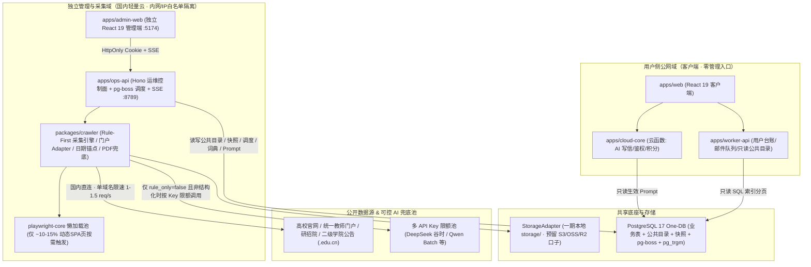
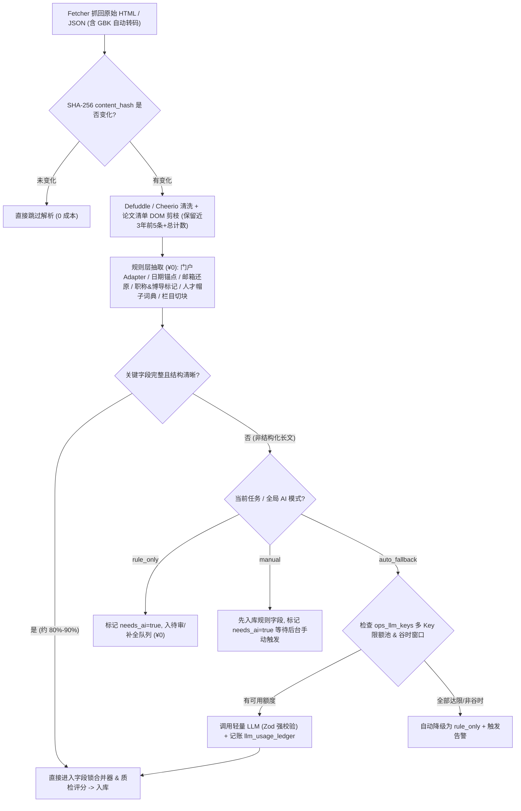
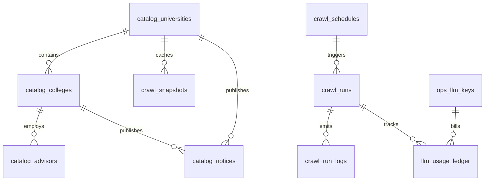

# PhD Cue · 独立采集引擎与运营管理端技术选型与架构设计

> **Figma 管理端高保真原型（已确认定稿）**：<https://www.figma.com/design/fXHPbkyFvuqplSL4lzLea9>
> **关联总纲文档**：[V2 需求、选型与架构设计总文档](V2_ARCHITECTURE_AND_PRD.md)
> **适用范围**：`apps/admin-web`（独立管理端前端）、`apps/ops-api`（独立管理端控制面与调度器）、`packages/crawler`（规则主导分层采集内核）及 `packages/db` 公共目录增量演进。

---

## 1. 核心设计原则与已锁定决策

1. **前后台彻底物理隔离（独立部署）**：
   - 管理端（`apps/admin-web` + `apps/ops-api`）与面向申请人的客户端（`apps/web` + `apps/cloud-core` + `apps/worker-api`）在前端产物、后端进程、鉴权机制和网络访问域上完全分离。
   - 原本置于客户端 [DataBackupSettingsPanel.tsx](../apps/web/src/views/settings/DataBackupSettingsPanel.tsx) 中的管理员 Prompt 控制台入口，在正式实施时迁入独立管理端，客户端编译产物零管理代码。
   - 前后台仅通过 PostgreSQL 17 公共目录表（`catalog_*`）与 `prompt_templates` 做**“后台写、客户端只读”**单向数据流转。
2. **规则绝对优先 + AI 按需可控 + 多 Key 限额池（Rule-First）**：
   - 软科榜单、统一门户接口、博达/超星等常见站群 DOM、通知公告日期锚点聚类、关键词白名单/排除词过滤、邮箱反爬还原、职称与人才帽子词典等 **80%–90% 结构化与半结构化字段全部走规则（¥0 成本）**。
   - **仅非结构化内容**（大段自由简历文本、复杂招生简章要点、沙盒 AI 修选择器、乱序 PDF 招生目录）才进入 AI 抽取。
   - 全局及单次任务均支持三档 AI 模式切换：**`rule_only`（纯规则 ¥0）** / **`manual`（手动触发 AI）** / **`auto_fallback`（规则优先 + 非结构化自动 AI 兜底）**，并配合多 API Key 日/月限额池与超限自动降级纯规则保护。
3. **不接入 OpenAlex（彻底移除外部学术图谱依赖）**：
   - 科研产出、论文与课题摘要、招生动态严格源自**高校/学院官网公开页面与人工兜底导入数据**，避免中文拼音同名张冠李戴与额外外部接口维护成本；现有前端卡片中对应文案在后续迭代中同步调整为“官网公开主页检索”。
4. **官网头像直链优先 + 预留对象存储扩展口子**：
   - Phase 1 直接采集并保存官网原始头像地址（`photo_url`），由客户端现有兜底机制处理裂图（`onError` 自动切换 `facehash` 几何头像），实现 **0 存储成本、0 图片带宽开销**。
   - 底层定义统一 `StorageAdapter` 接口（`LocalDiskStorage` ↔ `S3CompatibleStorage`）并预留 `photo_storage_key` 字段；招生目录 PDF 与本地临时文件一期直接落盘 `storage/`，后续多节点部署或需要防盗链转存时通过 `.env`（沿用 [.env.example](../.env.example) 已预留的 `S3_*` 变量）无痛切换至 OSS / COS / Cloudflare R2。
5. **支持任意非软科 Top 100 高校/科研院所手动扩展**：
   - 不仅覆盖软科 Top 100 自动化建档，管理端支持随时手动录入**非 Top 100 高校、双一流行业特色高校、中科院/科研院所及单个指定院系 URL**（`source_scope: "top100" | "custom_manual"`），支持自动子域探测或跳过探测直抓，纳入统一的规则沙盒与人工审核闭环。

---

## 2. 系统总体拓扑与独立部署架构



### 进程与网络拆分要点
- **为什么要拆出独立 `apps/ops-api`（不与 `worker-api` 合并）**：
  1. **稳定性隔离**：批量爬虫与懒加载无头浏览器存在瞬时内存/连接波动，独立进程避免影响用户端发信队列（SMTP/IMAP）的稳定性。
  2. **部署区域最优**：国内 `.edu.cn` 高校官网对境外节点常有高丢包或防火墙拦截，独立出的 `apps/ops-api` 可单独部署在国内轻量云节点（2C4G）直连高校网，而前端与用户云函数可按需灵活部署。
  3. **攻击面最小化**：`apps/admin-web` 与 `apps/ops-api` 仅挂载在内网/VPN/网关 IP 白名单之后；出站 Fetcher 保留私网/回环 IP 拦截（SSRF 防护，沿用并强化 [light-fetch.ts](../apps/cloud-core/src/scraper/light-fetch.ts) 实现）。

---

## 3. Monorepo 目录增量规划

```text
PhD_AdvisorContact_System/
├── apps/
│   ├── web/                       # [保留] 客户端（移除内置 AdminPromptDrawer 入口）
│   ├── cloud-core/                # [保留] 客户端 AI 网关（只读库内 prompt_templates）
│   ├── worker-api/                # [升级] catalog.ts 公共目录检索升级为 PG SQL 索引分页
│   ├── ops-api/                   # [新增] 独立管理端后端（Hono + pg-boss + SSE + Admin Cookie）
│   └── admin-web/                 # [新增] 独立管理端前端（React 19 + Vite 6 + Tailwind v4）
├── packages/
│   ├── shared/                    # [扩展] 采集任务/沙盒/审核/词典/Key池/护栏 Zod 契约
│   ├── db/                        # [扩展] sql/0002_ops_crawler.sql 与 Drizzle Schema
│   └── crawler/                   # [新增] 纯 TypeScript 采集内核（直接由 ops-api 与 admin-web 驱动，不设 CLI）
│       └── src/
│           ├── fetchers/          # Fetch + chardet/iconv-lite GBK转码 + 域限速桶 + CMS指纹探测
│           ├── adapters/          # 软科 BCUR/BCSR + 全校/院系域名探测 + 通用启发式
│           ├── extractors/        # 日期锚点公告提取 + DOM 剪枝 + 正则/词典抽提 + RSS可选兼容
│           ├── ai/                # 3 模式控制器 + 多 Key 限额轮转器（按需扩展）
│           ├── merger/            # manual_locked_fields 防覆盖合并器 + 4态招博判定
│           ├── storage/           # StorageAdapter 接口（LocalDiskStorage / 预留 S3Storage）
│           └── pipelines/         # 可直接入库的学院/高校采集编排管线
└── docs/
    └── CRAWLER_AND_OPS_ARCHITECTURE.md
```

---

## 4. 全栈分层技术选型清单

| 技术层次 | 最终选型 | 核心职责 | 排除项与取舍原因 |
| :--- | :--- | :--- | :--- |
| **管理端前端 (`apps/admin-web`)** | `React 19` + `Vite 6` + `Tailwind CSS v4` + `@base-ui/react` + `TanStack Router` + `TanStack Query` + `TanStack Table v8` + `echarts/core`（按需）+ `diff` (`jsdiff`) | 5 大管理端视图（含 02B 非 Top 100 向导、04A/04B 分屏审核）、14 天吞吐/费用双轴图、Prompt 版本逐行 Diff | **不引入 Ant Design / Monaco Editor**（保持包体轻量与统一视觉语言）；10×10 院校健康矩阵采用纯 CSS Grid + Base UI Tooltip |
| **管理端后端 (`apps/ops-api`)** | `Hono` + `pg-boss` + Hono `streamSSE` + 升级版 `admin-guard`（签名 `HttpOnly` Cookie + `X-Admin-Token`） | 运维控制面 API、持久化 Cron 与队列调度、实时日志 SSE 推送、操作审计 | **不引入 Redis / BullMQ**，继续贯彻 PostgreSQL 17 One-DB 零额外中间件策略 |
| **静态抓取快车道 (85% 页)** | Node 原生 **`undici`** + **`chardet`** + **`iconv-lite`** + **`cheerio`** + **`defuddle`** | 复用 HTTP 连接池；自动探测并解码 GBK/GB2312 老旧院系网页；剔除导航/页脚噪音提取纯净正文 | **排除 Firecrawl / Jina 作为主力**（按页计费昂贵且海外节点抓 `.edu.cn` 丢包率高）；相比 `Turndown` 更抗乱码与截断 |
| **动态降级兜底 (15% 页)** | **`playwright-core`**（单 BrowserContext 懒加载池，禁用图片/字体/媒体加载） | 仅针对纯前端 SPA、JS 挑战或 403 页面在队列/沙盒中按需启用 | **不默认全量开启浏览器**，避免内存与 CPU 飙升；任务状态完全托管于 PG，而非 Crawlee 本地磁盘文件 |
| **礼貌限速与域熔断** | 自研 **Per-Domain Token Bucket**（单域名并发=1、速率 1–1.5 req/s + 随机抖动）+ 域级熔断器 | 跨 100+ 高校全局并发 12–20 时总吞吐稳定且不压垮单校虚拟主机；单校连续失败 5 次冷却 30 分钟 | 严控对高校内网虚拟主机冲击，显著降低 403/IP 封禁概率 |
| **规则引擎 & AI 可控兜底** | **Rule-First**：正则 + `ops_rule_dictionaries` + 门户 Adapter + 日期锚点聚类；<br>**AI 兜底**：复用 Vercel AI SDK（支持 **DeepSeek / 阿里云百炼 Qwen Batch** 等 OpenAI-compatible Provider），强制关闭 Thinking 模式 | 80%–90% 字段 0 成本规则直出；仅对非结构化长简历、复杂招生正文、沙盒 AI 修选择器或乱序 PDF 调模型，严格受 `rule_only` / `manual` / `auto_fallback` 与多 Key 限额池控制 | **禁止全局无差别送入 LLM**，**禁止调用高费率推理（Reasoner）模型** |
| **PDF 招生目录兜底** | 文字版：**`unpdf`**（零原生二进制依赖）+ 规则/轻量 LLM 表格结构化；扫描版：按需走轻量视觉模型兜底 | 解决极少数院系仅发布 PDF 博士招生目录或博导名单的死信问题 | 保留 `PdfParserAdapter` 抽象接口，必要时可外挂轻量脚本而不耦合主进程 |
| **存储策略** | **头像**：Phase 1 直接存官网 `photo_url`；<br>**附件/快照**：本地 `storage/` + PostgreSQL；<br>**扩展**：`StorageAdapter`（预留 `S3CompatibleStorage`） | 0 额外存储费用与运维成本；客户端对裂图已有 `facehash` 无感兜底 | **一期不强制部署 MinIO / 购买 OSS**，仅通过接口与 `photo_storage_key` 预留平滑迁移通道 |

---

## 5. 核心机制设计

### 5.1 Rule-First 抽取漏斗与三档 AI 模式



- **规则层覆盖清单（¥0）**：
  1. **高校/学院发现**：软科 BCUR (`payload.js` 动态提取) + BCSR 学科排名 JSON API；高频子域并发字典探测（`faculty.` / `teacher.` / `jszy.` / `person.` / `yz.` / `yzb.` / `gs.`）；学院首页导航锚文本一次性同步提取 `faculty_list_url` 与 `notice_list_url`。
  2. **邮箱反爬还原**：支持 `mailto:`、`[at]` / `(at)` / `#` / `（at）` / HTML 实体字符还原；仅在原文明确存在时入库，**绝不猜测拼接**。
  3. **人才帽子分级词典**：依托 `ops_rule_dictionaries` 精确匹配国家级（院士/杰青/优青/海外优青/长江/万人）与省部级人才称号，100% 稳定映射 `honor_category`。
  4. **学院公告通用抽取（日期锚点 + 兄弟同构聚类）**：扫描页面含日期正则的叶子节点 → 向上找含有效中文标题 `<a>` 的最小同构兄弟容器 → 剔除 `<nav>`/`<footer>` → 先按 URL 去重，再过白名单/排除词库滤除 ~95% 非招生杂务；对少数奇葩改版页在沙盒中执行一次「AI 生成 CSS 选择器」并缓存到 `notice_rule_json`，后续恢复 ¥0 规则巡检。
  5. **导师长简历 DOM 剪枝**：遇到含上百篇论文的主页时，正则计数并截取近 3 年前 5 条，强行保护底部的联系方式与招博说明段落不被截断。

### 5.2 非软科 Top 100 高校手动扩展机制
在 `catalog_universities` 中引入 `source_scope`（`top100` | `custom_manual`）与 `custom_tags`：
- **路径 A（域名自动探测，适合整校扩展）**：管理员在管理端 `02B` 输入校名与主域名（如 `西南石油大学` / `swpu.edu.cn`）→ 控制面在 ~3 秒内并发探测统一教师平台、研究生院、教务/院系设置页 → 勾选需要纳管的学院后即可启动首轮规则抓取。
- **路径 B（跳过探测 · 直接按自定义 URL 抓取，适合单个研究所/特定学院）**：管理员直接粘贴任意师资列表页或公告栏 URL，跳过整校探测直接进入规则试抓与入库调度。

### 5.3 多 API Key 限额池与预算熔断
- 新增 `ops_llm_keys` 表：管理员可录入多条 Key（如 `DeepSeek #1` 设日限 ¥5 且勾选仅谷时，`Qwen Batch #2` 设月限 ¥100），AES-256-GCM 加密存储（复用 [crypto.ts](../packages/db/src/crypto.ts)）。
- 每次准备触发 LLM 前：
  1. 若开启**谷时锁定**且当前不在低谷时段（如 00:30–08:30），批量任务自动延迟进谷时队列；
  2. 按优先级选取未达日/月限额的可用 Key；单 Key 达限自动轮转至下一组；
  3. **所有 Key 均达限或月度总预算达到 100%**：自动触发安全降级，将系统切换为 `rule_only` 纯规则模式并写入运维告警，绝不产生预算外扣费。

### 5.4 字段级「人工锁定防覆盖」合并与质检门控
- 每条高校/学院/导师记录均带有 `manual_locked_fields (jsonb string[])`。
- 管理员在 `04A` 人工审核台修改并锁定的字段（如手工修正的邮箱、招博名额、帽子头衔），爬虫再次执行 Upsert 时**严格跳过锁定字段**，仅补充未锁定的空白/过时字段。
- 入库后自动计算 `quality_score`（0–100）：姓名、院系、方向、有效邮箱/主页齐全且通过基础校验（`>= 75`）自动 `auto_published`；缺少关键字段或纯规则切分失败（`needs_ai = true`）则流转至 `04A` 待审队列。

### 5.5 头像直链与对象存储预留口子
- **一期策略**：抓取时提取规范化绝对 `photo_url` 直接入库，前端 [DiscoverView.tsx](../apps/web/src/views/DiscoverView.tsx) 与 [AdvisorPhotoModal.tsx](../apps/web/src/components/AdvisorPhotoModal.tsx) 通过 `` 自动回退到确定性 `facehash` 几何头像。
- **代码抽象**：`packages/crawler/src/storage/` 定义标准 `StorageAdapter`（`putObject / getSignedOrPublicUrl / deleteObject`），默认实现为 `LocalDiskStorage`（写入 `storage/`）；数据库预留 `catalog_advisors.photo_storage_key` 与 `catalog_notices.attachment_storage_keys`。当未来开启 `.env` 中的 `S3_ENDPOINT / S3_BUCKET` 时，仅需启用 `S3CompatibleStorage` 即可对失效防盗链头像开启异步转存。

### 5.6 博导默认常规在招语义（领域硬规则）
在博士申请场景中，**只要具有博士生导师资格，默认即常规招收博士生**（多数高校教师主页仅写“博士生导师”，不会逐年更新“今年招 1 名”）。为此引入 4 态招博模型（`recruitment_status` + `is_phd_supervisor` + `recruit_open`）：
1. **明确负向优先 (`explicitly_closed`, `recruit_open=false`)**：正文出现 `已退休` / `荣休` / `暂停招生` / `本年度不招收博士` / `不再招收博士` / `名额已满` 等明确负向信号。
2. **明确招博信号 (`confirmed_open`, `recruit_open=true`)**：个人主页或核准的招博公告出现当年明确招博/指标说明（如 `2026/2027年拟招收博士`、`欢迎报考博士`、`尚有博士名额`）。
3. **博导默认在招 (`phd_default_open`, `recruit_open=true`)**：个人主页/职称出现 `博士生导师`、`博导`、`博士研究生导师`、`Ph.D. Supervisor`，或来自学院“博士研究生导师”专页且无负向信号，默认设为 `recruit_open = true`，指标卡展示 `常规招博（博导默认在招）`，引导申请人发信附带研究设想核实具体名额。此外，针对清华、北大等部分不在个人页单列“博导”二字的重点高校，正高（`教授`/`研究员`）及`长聘/准聘教授、副教授`在无退休/停招信号时同样默认归入 `phd_default_open`。
4. **身份未确认 (`unknown`, `recruit_open=false`)**：未能确认博导资格者暂不标为在招，可留待后续人工核查或公告联动。

### 5.7 15 校实测与 25+ 站官方 RSS 摸底修正规则
基于对软科前 40 含手动非 Top 100 校共 15 所计算机学院与 25+ 学院/研招站的线上实测，采集引擎固化以下 6 条工程硬规则：
1. **WebVPN 代理链接还原**：部分高校对外官网静态页遗留校内 WebVPN 链接（如 `http://homepage-hit-edu-cn.ivpn.hit.edu.cn:1080/xxx`），请求前自动剥离 `.ivpn.` / `.webvpn.` 还原为公网域名（`https://homepage.hit.edu.cn/xxx`）。
2. **小体积过渡页自动跟随**：如遇 `< 8KB` 且包含 `中文网` / `进入主页` / `main.htm` 的门户引导页（如部分高校计算机学院首屏），自动跟进 1 次真实内页后再识别 CMS 与导航。
3. **列表页 + 详情页 + 统一主页三源合并**：部分高校将邮箱直接写在师资列表页而个人详情页无邮箱，解析列表页时同步保留行内邮箱/职称/博导专页上下文，并在写入前合并。
4. **通知日期格式扩展与无日期兜底**：除常规 `YYYY-MM-DD`/`/`/`.` 外，同步解析 `DD YYYY/MM` 与 `DD 中文月`（如 `27 八月`）；针对完全不展示日期的列表（如 `list.jsp`），自动回退为最大同构 `ul > li > a` 聚类。
5. **官网头像黑名单与 `Content-Type` 校验**：过滤 `_visitcount`、统计像素、`logo`、`icon`、`banner`、`qrcode`、`.svg` 等伪图片链接，并在可行时验证响应 `content-type: image/*`，失真链接一律置空交由客户端 `facehash` 兜底。
6. **官方 RSS 定位**：实测 25+ 学院与研招官网公开可用标准 RSS 为 0%，且博达后台隐藏的 `rssfeed.jsp` 存在未设源占位报错或已被清华/华科/西交禁用。因此通知抓取主链路**坚定采用公开 HTML 日期锚点与列表聚类**，`notice_strategy` 仅保留可选 `rss_feed` 兼容海外主页或显式声明 `<link rel="alternate" type="application/rss+xml|atom+xml">` 的站点。

---

## 6. PostgreSQL 17 增量数据模型（`0002_ops_crawler.sql`）

在保留现有 [0001_init.sql](../packages/db/sql/0001_init.sql) 全部表结构向后兼容的前提下，做如下幂等增量扩展（**不含任何 OpenAlex 字段**）：



### 各表精确字段规划

1. **`catalog_universities`（增量加列）**
   - `source_scope TEXT NOT NULL DEFAULT 'top100'`（`top100` | `custom_manual`）
   - `official_domain TEXT NOT NULL DEFAULT ''`
   - `portal_bucket TEXT NOT NULL DEFAULT 'decentralized'`（`unified_api` | `boda_cms` | `chaoxing_cms` | `decentralized` | `custom`）
   - `adapter_key TEXT NOT NULL DEFAULT ''`
   - `health_status TEXT NOT NULL DEFAULT 'unprobed'`（`unprobed` | `healthy` | `degraded` | `broken`）
   - `enabled BOOLEAN NOT NULL DEFAULT TRUE`
   - `custom_tags JSONB NOT NULL DEFAULT '[]'::jsonb`
   - `manual_locked_fields JSONB NOT NULL DEFAULT '[]'::jsonb`
   - `last_probed_at TEXT`

2. **`catalog_colleges`（新增 · 二级学院与规则载体）**
   - `id TEXT PRIMARY KEY`
   - `university_id TEXT NOT NULL REFERENCES catalog_universities(id) ON DELETE CASCADE`
   - `name TEXT NOT NULL`
   - `discipline_category TEXT NOT NULL DEFAULT ''`
   - `college_url TEXT NOT NULL DEFAULT ''`
   - `faculty_list_url TEXT NOT NULL DEFAULT ''`
   - `notice_list_url TEXT NOT NULL DEFAULT ''`
   - `phd_admission_url TEXT NOT NULL DEFAULT ''`
   - `cms_fingerprint TEXT NOT NULL DEFAULT 'unknown'`（`boda_vsb` | `sudi_webplus` | `unified_portal` | `custom_static` | `ruishu_waf` | `unknown`）
   - `faculty_strategy TEXT NOT NULL DEFAULT 'http'`（`adapter` | `http` | `playwright` | `paused`）
   - `notice_strategy TEXT NOT NULL DEFAULT 'date_anchor'`（`date_anchor` | `rss_feed` | `css_rule` | `playwright` | `paused`）
   - `faculty_rule_json JSONB`、`notice_rule_json JSONB`
   - `charset_hint TEXT NOT NULL DEFAULT ''`
   - `consecutive_empty_runs INTEGER NOT NULL DEFAULT 0`
   - `health_status TEXT NOT NULL DEFAULT 'unprobed'`
   - `last_faculty_crawl_at TEXT`、`last_notice_crawl_at TEXT`
   - `manual_locked_fields JSONB NOT NULL DEFAULT '[]'::jsonb`
   - `created_at TEXT NOT NULL`、`updated_at TEXT NOT NULL`
   - 唯一约束：`UNIQUE(university_id, name)`

3. **`catalog_advisors`（增量加列 + 全文与标签索引）**
   - 新增列：
     - `college_id TEXT REFERENCES catalog_colleges(id) ON DELETE SET NULL`
     - `source_key TEXT UNIQUE`（幂等防重键：`uniId::normalized(homepageUrl)` 或 `uniId::dept::name`）
     - `is_phd_supervisor BOOLEAN NOT NULL DEFAULT TRUE`
     - `recruitment_status TEXT NOT NULL DEFAULT 'phd_default_open'`（`confirmed_open` | `phd_default_open` | `explicitly_closed` | `unknown`）
     - `recruitment_signal_note TEXT NOT NULL DEFAULT ''`
     - `is_active BOOLEAN NOT NULL DEFAULT TRUE`
     - `content_hash TEXT NOT NULL DEFAULT ''`
     - `extract_mode_used TEXT NOT NULL DEFAULT 'rule'`（`rule` | `rule_plus_ai` | `manual`）
     - `needs_ai BOOLEAN NOT NULL DEFAULT FALSE`
     - `quality_score INTEGER NOT NULL DEFAULT 80`
     - `review_status TEXT NOT NULL DEFAULT 'auto_published'`（`auto_published` | `needs_review` | `verified` | `hidden`）
     - `review_reasons JSONB NOT NULL DEFAULT '[]'::jsonb`
     - `photo_storage_key TEXT NOT NULL DEFAULT ''`（预留对象存储 Key，一期为空，直接读 `photo_url`）
     - `manual_locked_fields JSONB NOT NULL DEFAULT '[]'::jsonb`
   - **客户端查询性能升级**：为 `research_tags` 建立 `GIN` 索引，为 `name`、`dept`、`bio` 建立 `pg_trgm` GIN 索引，并将客户端 [catalog.ts](../apps/worker-api/src/routes/catalog.ts) 从全表读取内存过滤升级为 **SQL 条件过滤 + 分页查询**，平滑支撑 7–10 万级导师规模。

4. **`catalog_notices`（新增 · 公共招博通知池）**
   - `id`, `university_id`, `college_id`, `source_url (UNIQUE)`, `title`, `published_at`, `matched_keywords (jsonb)`, `raw_markdown`, `summary`, `deadline_at`, `admission_type`, `english_req`, `extracted_advisor_names (jsonb)`, `attachment_urls (jsonb)`, `review_status` (`pending` | `approved` | `false_positive`), `linked_advisor_count`, `crawled_at`, `created_at`, `updated_at`

5. **`crawl_snapshots`（新增 · 网络与解析解耦快照表）**
   - `id`, `url (UNIQUE)`, `entity_type` (`college_home` | `advisor_list` | `advisor_detail` | `notice_list` | `notice_detail`), `university_id`, `college_id`, `http_status`, `etag`, `last_modified`, `content_hash`, `cleaned_markdown`, `pruned_markdown`, `extracted_json (jsonb)`, `status` (`pending` | `fetched` | `parsed` | `failed` | `dead_letter`), `error_category`, `error_message`, `retry_count`, `fetched_at`, `parsed_at`

6. **`crawl_schedules` / `crawl_runs` / `crawl_run_logs`（新增 · 定时与手动调度）**
   - `crawl_schedules`：持久化 4 条核心管道（`rank_sync`、`advisor_incremental`、`grad_school_notice`、`college_notice`）、`cron_expr`、`season_mode`（`peak` | `off_peak`）、`off_peak_llm_only`、`ai_mode`、`enabled`、`next_run_at`。
   - `crawl_runs`：记录每次发车范围（`top100` | `custom_manual` | `selected_entities` | `ad_hoc_urls`）、`ai_mode`、`replay_snapshots_only`、总页数、Hash 跳过数、规则直出数、AI 调用数、预估费用、实际费用、状态与控制标志。
   - `crawl_run_logs`：按 `403_blocked` / `timeout` / `gbk_fixed` / `empty_selector` / `zod_invalid` 归因，驱动管理端一键过滤与定向重试。

7. **`ops_llm_keys` / `llm_usage_ledger` / `ops_rule_dictionaries` / `ops_guardrails_config` / `ops_audit_logs`（新增 · 治理与账本）**
   - `ops_llm_keys`：`id`, `label`, `provider`, `base_url`, `model`, `encrypted_api_key`, `daily_budget_cny`, `monthly_budget_cny`, `used_today_cny`, `used_month_cny`, `rpm_limit`, `off_peak_only`, `priority`, `enabled`, `exhausted_until`。
   - `llm_usage_ledger`：记录 `key_id`, `run_id`, `purpose` (`advisor_extract` | `notice_parse` | `selector_fix` | `pdf_parse`), `input_tokens`, `output_tokens`, `cached_tokens`, `cost_cny`, `created_at`。
   - `ops_rule_dictionaries`：`kind` (`honor_national` | `honor_provincial` | `notice_whitelist` | `notice_blacklist`) + `entries (jsonb)`。
   - `ops_guardrails_config`：单例配置（默认 `ai_mode`、月度总预算熔断阈值、单域名并发、单域每秒限速、连败冷却分钟数、头像存储策略开关）。
   - `ops_audit_logs`：记录所有人工审核、字段锁定、规则改写、Prompt 发布与调度操作。

---

## 7. `apps/ops-api` 接口契约（与 Figma 6 大视图 1:1 对齐）

除 `POST /api/ops/auth/login` 外，所有 `/api/ops/*` 接口均强制通过管理端鉴权中间件（支持 `HttpOnly` 签名 Session Cookie + `X-Admin-Token`）：

| 所属模块 | 核心接口路由 | 对应 Figma 视图与操作 |
| :--- | :--- | :--- |
| **鉴权** | `POST /api/ops/auth/login` · `POST /logout` · `GET /me` | 管理端独立登录态校验 |
| **驾驶舱** | `GET /api/ops/overview?days=14` | **`01`**：4 维 KPI、14 日吞吐/费用趋势、门户分桶与健康矩阵、收件箱告警 |
| **院校源 & 沙盒** | `GET/POST/PATCH /api/ops/sources/universities`<br>`GET/POST/PATCH /api/ops/sources/colleges`<br>`POST /api/ops/sources/sync-softscience`<br>`POST /api/ops/sandbox/test-url`<br>`POST /api/ops/sandbox/ai-fix-selector` | **`02A`**：树表、软科同步、右侧沙盒试抓与 AI 修选择器 |
| **非 Top 100 扩展** | `POST /api/ops/sources/probe-university`<br>`POST /api/ops/sources/onboard-university` | **`02B`**：输入校名与主域名一键探测门户/学院，或跳过探测按自定义 URL 直接抓取入库 |
| **调度与任务** | `GET/PATCH /api/ops/schedules` · `POST /schedules/season`<br>`POST /api/ops/runs/estimate` · `POST /api/ops/runs`<br>`POST /api/ops/runs/:id/{pause,resume,cancel,retry-failed}`<br>`GET /api/ops/runs/:id/stream` (SSE) | **`03`**：淡旺季切换、4 管道开关、发车前规则/AI 费用预估、实时进度条与分类日志重试 |
| **人工审核台** | `GET /api/ops/hitl/advisors` · `PATCH /hitl/advisors/:id`（含 `lockedFields`）<br>`POST /api/ops/hitl/advisors/:id/ai-refine`<br>`GET /api/ops/hitl/notices` · `POST /hitl/notices/:id/{approve,false-positive}`<br>`POST /api/ops/hitl/fallback/{parse-text,parse-pdf,commit}`<br>`POST /api/ops/hitl/advisors/merge` | **`04A` + `04B`**：分屏对照校对、字段防覆盖锁、单条手动 AI 精炼、招博通知核准批量点亮 `recruit_open`、死信文本/PDF 解析与实体合并 |
| **护栏与 Prompt** | `GET/PUT /api/ops/guardrails` · `GET/POST/PATCH /api/ops/llm-keys`<br>`GET/POST/DELETE /api/ops/dictionaries/:kind`<br>`GET/PUT/POST /api/ops/prompts/*` | **`05`**：3 档 AI 模式开关、多 Key 限额池、礼貌采集护栏、三类词典与统一 Prompt 版本管理 |

---

## 8. 垂直切片落地路线与验收标准（无 CLI · Web 优先）

1. **Stage 1 · 垂直切片贯通（底座 + 核心采集内核 + `ops-api` + `admin-web` V1）**
   - 落地 `packages/db/sql/0002_ops_crawler.sql`、更新 Drizzle Schema 与 `@app/shared` 契约（含 4 态招博模型、官方 RSS 可选策略与非 Top 100 扩展字段）；
   - 搭建纯 TS `@app/crawler` 采集内核（SSRF + WebVPN 还原 + GBK 自动转码 + 过渡页跟随 + 域限速 + 软科 Top 100 同步 + 整校域名探测 + 规则沙盒提取 + 博导默认在招判定）；
   - 上线独立控制面 `apps/ops-api (:8789)` 与独立管理端 `apps/admin-web (:5174)`，在浏览器直接完成「同步软科 Top 100」「非 Top 100 探测向导」「规则沙盒实时试抓」「单学院入库触发」「人工字段锁与词典/AI模式配置」。
2. **Stage 2 · AI 按需兜底、Playwright 懒加载与定时调度队列**
   - 接入 `pg-boss` 持久化 Cron 与 SSE 实时日志流；
   - 接入 `auto_fallback` / `manual` AI 精炼与多 Key 日/月限额自动轮转降级，以及瑞数 WAF 页面按需 `playwright-core` 降级与 PDF 目录 `unpdf` 兜底。
3. **Stage 3 · Prompt 中心迁出与客户端公共库 SQL 分页升级**
   - 将原客户端 Prompt 调优中心完整迁入 `apps/admin-web`，彻底剥离 `apps/web` 中的管理员代码；
   - 将客户端 [catalog.ts](../apps/worker-api/src/routes/catalog.ts) 升级为 PostgreSQL 17 `GIN + pg_trgm` 条件过滤与分页查询。
4. **Stage 4 · 全量铺开与淡旺季自动巡检**
   - 在管理端分批完成 Top 100 与重点非 Top 100 院校建档与规则调优，启用淡旺季自动公告巡检与人工审核日常流。
