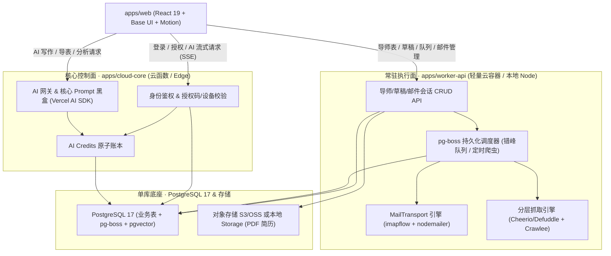
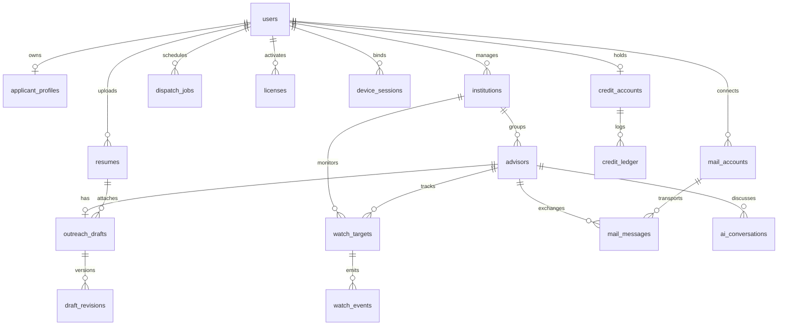

# PhD_AdvisorContact_System V2（申博轻邮 · 全栈重构版）需求与架构设计文档

> **分支定位**：本分支（`refactor/v2`）为全栈 TypeScript 彻底重构分支。旧版 V1（Python 单体服务 + Excel 实时同步 + 便携打包）完整保留在 `main` 分支，不作改动。

---

## 1. 项目定位、重构背景与核心目标

### 1.1 重构背景：为什么从 V1 走向 V2

V1 验证了“学术套磁写信工作台 + 错峰防封发送 + 白名单回信追踪 + AI 辅助写作/导表”的核心需求闭环，但随着产品向 **Web 化体验、强交互动效、深度 AI Agent、网页定时监听与商业化演进** 迈进，V1 架构暴露出明显瓶颈：

| 对比维度 | V1（`main` 分支 · 本地 Python 便携版） | V2（`refactor/v2` · 全栈 TypeScript 架构） |
| :--- | :--- | :--- |
| **产品形态** | 本地 Python HTTP 服务 + Tkinter 控制窗 + 便携 `.exe` | 现代化 **Web 优先（Web-First）**工作台（未来可无缝复用包装桌面端） |
| **数据存储** | 实时读写本地 18 列 `.xlsx` + 零散 `email.txt` / JSON 文件 | **PostgreSQL 17** 结构化单库底座（支持 JSONB、队列与向量检索） |
| **交互与美学** | 纯白克制工具风，通用 Radix 封装，缺少物理触感与连贯动效 | **Family 级轻触感 + 轻磨砂玻璃 & 克制微荧光**，全身心打磨弹簧动效 |
| **AI 协同方式** | 扁平文本拼接输入，一次性响应，聊完即丢、不回写结构化洞察 | **AI-Native 结构化协同**：真实科研履历边界 + 流式输出 + 沉淀分析卡片 |
| **抓取与监听** | 仅支持单次粘贴网页文本或单页抓取提取导师 | 分层抓取管道 + **定时巡检与页面变更监听（招生简章/导师主页更新提醒）** |
| **商业化与安全** | 用户自备 DeepSeek API Key，代码全部本地执行，无防逆向保护 | **云函数控制面（`cloud-core`）隔离核心 Prompt、鉴权、授权码与 AI Credits** |

### 1.2 五大核心重构目标

1. **体验与动效跃迁**：引入无头原语 + 物理弹簧动效体系，实现接近原生 iOS / Family 应用的跟手触感、共享元素形变、丝滑状态切换与统一风格的人物几何头像。
2. **AI-Native 深度协同**：将申请人履历、导师成果、回信上下文、草稿版本全部结构化入库，形成“事实输入 AI → 严格约束防幻觉 → 结构化产出回写数据库”的正循环。
3. **前瞻但极简的数据基座**：采用 **PostgreSQL One-DB** 架构（同时承担关系表、JSONB、持久化任务队列、全文模糊检索及未来向量语义匹配），零 Redis 等额外中间件运维负担。
4. **可商业化与防逆向边界**：提前划清控制面（云函数黑盒）与执行面（常驻 Worker）职责，无缝承接未来的账号体系、买断/订阅授权码、设备数限制与 **AI Credits 原子积分账本**。
5. **工程与分支极致整洁**：采用 `mise` + `pnpm` Workspace Monorepo 统一前后端 TypeScript 类型契约，新分支从零保持清爽干净的目录与依赖规范。

---

## 2. 需求全景与 V1 → V2 功能演进矩阵

| 业务模块 | V1 原有功能 | V2 重构定位与升级点 | 规划阶段 |
| :--- | :--- | :--- | :--- |
| **导师名录与进度管理** | 读写本地 18 列 `.xlsx`；按高校分表；左栏筛选 + 进度总表 | **放弃 `.xlsx` 实时读写绑定**，升级为 PostgreSQL 主数据 + `TanStack Table` 网页多维表（虚拟滚动、行内快改状态/匹配度、分组聚合统计）；提供轻量 **CSV / JSON 导入导出** 作为迁移备份通道 | Phase 1 |
| **申请人名片与简历** | 单一 `research_summary` 文本框；默认/专属 PDF 上传、预览、Ghostscript 压缩 | **结构化科研履历**（论文列表、项目经历、研究方法标签 JSONB）+ 上传 PDF 自动提取纯文本缓存（`cv_parsed_text`）喂给 AI；保留默认/专属 PDF 关联与浏览器预览 | Phase 1 |
| **套磁写信与模板** | 富编辑区、1.1s 防抖保存、撰写/预览切换、规则模板初稿、复制 | 保留全功能并新增 **草稿版本快照（`draft_revisions`）**，AI 改坏可随时回退对比；快捷状态切换与发送前清单检查 | Phase 1 |
| **AI 写作助手与智能导表** | 对话栏 6 个快捷胶囊（生成/润色/精简/英文/切入点/回信）、网页文本提取 30 位导师 | 升级为 **Vercel AI SDK 流式输出（SSE）+ Zod 强类型结构化提取**；对话按导师持久化；AI 评估结果回写 `ai_insights` 卡片（契合点、推荐钩子、风险提示） | Phase 1 |
| **单封直发与会话追踪** | 导师页单发、自由写新邮件、先发给自己测试、往来会话折叠、同线索回复 | 保留全部能力，邮件往来结构化入库；支持 **AI 回信意图自动分类**（积极约面 / 欢迎报考 / 暂无名额 / 需补材料）与待办提炼 | Phase 1–2 |
| **批量错峰与定时队列** | 内存线程执行、同校域名交错、随机延时、预约启动、配额限制 | 从内存线程升级为 **`pg-boss` 持久化防丢队列**（服务重启不丢失定时与进度）；实时进度推送、可视化倒计时与可控暂停/终止 | Phase 1 |
| **网页抓取与变动监听** | 无（仅手工触发单页提取） | **V2 新增核心能力**：对高校官网师资页、博士招生简章页配置定时抓取（`Cheerio` + `Defuddle` / `Crawlee`），SHA-256 去重 + `fast-diff` 语义变更提醒 | Phase 2 |
| **语义推荐与多步 Agent** | 无 | 启用 `pgvector` 按个人科研履历语义检索匹配博导；按需引入 `Mastra` 实现“调研主页 → 暂停确认 → 批量起草”的多步可挂起工作流 | Phase 2 |
| **账号、授权与 AI 积分** | 无（单机免登录，自备 DeepSeek Key） | **云函数黑盒化**：Better Auth 登录、设备与买断/订阅授权码验证、平台统一 AI 网关与 **AI Credits 原子扣费账本**（用户无需自备 API Key） | Phase 3 |

---

## 3. 视觉设计语言与动效交互规范

### 3.1 视觉基调：Playful Tactile Minimalism（轻触感极简趣玩）

融合 **`Cue!` 图标的圆润几何萌感** 与 **`Family` 的苹果级纯净触感**，并在浮层引入 **一丢丢轻磨砂玻璃与克制微荧光**：

- **画布与色彩（Clarity First）**：
  - 主工作区保持高呼吸感纯白（`#FFFFFF`）与极浅冰灰侧栏（`#F8F9FB`），确保长时间阅读和撰写学术长信零视觉疲劳。
  - 品牌主色使用高饱和明快电光蓝（`#2563EB` / `#3695FF`），辅助状态色采用柔和珊瑚红（新回信提醒）、薄荷绿（已发送/通过）与暖琥珀（待核实/超限提醒）。
- **轻磨砂玻璃浮层（Subtle Frosted Glass）**：
  - 仅用于浮于内容之上的结构层（顶栏导航、命令面板 `cmdk`、AI 悬浮输入框、右侧悬浮工具栏）：`backdrop-blur-xl` + 高透纯白半透明底 + 顶部 `1px` 纯白内高光描边 + 轻柔环境投影。
- **克制微荧光（Restrained Ambient Glow）**：
  - 绝不铺满霓虹渐变，仅在情绪焦点克制使用：AI 助手思考/激活边框的淡电光蓝-青紫微晕、主 CTA 按钮底部淡淡的彩色漫反射阴影、新回信提示卡片边缘的浅珊瑚柔光。

### 3.2 动效交互准则（Motion Design System）

以 **`Motion` (`motion/react`) + `Vaul` + `Animate UI / Motion Primitives`** 构建统一物理手感的动效体系：

1. **拒绝生硬 `scale(0)`**：所有弹窗、下拉菜单、气泡卡片均从 `scale: 0.92~0.96` 配合透明度快速弹性展开，结合 **Base UI Origin-aware** 定位，从触发按钮原点自然生长。
2. **即时按压触感**：主交互按钮统一配置 `active:scale-[0.97]` 与短时长物理弹簧，提供类似实体软胶按键的按压回弹。
3. **布局连续性（`layout` / `layoutId`）**：选项卡胶囊切换、卡片到详情模态框展开（Morphing Dialog）、AI 面板显隐、列表过滤重排均保持连续空间过渡，避免页面硬跳变。
4. **Family 级抽屉手感**：使用 `Vaul` 实现带物理阻尼、手势拖拽关闭及底层画布微缩反馈的侧边/底部抽屉。
5. **数字滚动质感**：AI Credits 余额变更、已发/回信统计数采用滑动数字动画（Sliding Number）。
6. **无障碍与性能底线**：严格只对 `transform`、`opacity` 和 GPU 合成属性做动画，完整响应 `prefers-reduced-motion`。

### 3.3 风格化随机头像与品牌吉祥物

- **导师确定性几何头像（首选 `facehash`）**：
  - 体积仅 ~3KB 零依赖，按导师姓名/邮箱生成唯一且固定的极简几何萌脸 SVG，天然契合 `Cue!` 的眨眼颜文字神韵。
  - 启用 `intensity3d` 微立体深度与 `enableBlink` 自动眨眼微动效，外圈包裹轻磨砂高光边框，色板收敛为品牌电光蓝、薄荷、珊瑚、浅薰衣草等温和色系。
- **备选与扩展样式**：内置 **`@dicebear/core` + `@dicebear/collection` (`glass`)** 作为可选「磨砂玻璃抽象块」头像/高校图标样式；后期可选引入 **`Rive`** 实现鼠标跟随、收信起飞的矢量交互吉祥物。

---

## 4. 全栈 TypeScript 技术选型清单与取舍依据

| 技术层次 | 最终选型 | 核心职责 | 排除项与取舍原因 |
| :--- | :--- | :--- | :--- |
| **工程与工具链** | `mise` + `pnpm` Workspace + `Node.js 22+` + `TypeScript 5.x` | 统一环境版本、Monorepo 依赖共享与跨包强类型编译 | 放弃 npm/yarn，利用 pnpm 硬链接与 Workspace 保持磁盘与依赖树干净 |
| **前端核心底座** | `React 19` + `Vite 6` + `Tailwind CSS v4` | 高帧率重交互 SPA 工作台 | 纯 SPA 响应快，未来如需 Tauri 桌面套壳可直接复用 |
| **路由与状态管理** | `TanStack Router` + `TanStack Query` + `Zustand` | 类型安全路由、服务端缓存/乐观更新、本地编辑器状态 | 告别 V1 千行单文件 `App.tsx` 状态耦合；服务端与本地 UI 状态严格分离 |
| **UI 无头原语与动效** | `Base UI` (`@base-ui/react`) + `Motion` + `Vaul` + `Animate UI` / `Motion Primitives` / `SmoothUI` | 无样式可访问底座 + 物理动效 + 抽屉 + 微扫光/弹性交互片段 | **放弃 Ant Design / MUI**（企业后台感重，难改出轻触感）；**Base UI 优于 Radix**（原生 Combobox/NumberField/Origin-aware，无 `asChild` ref 合并坑） |
| **表格与通用组件** | `TanStack Table v8` + `TanStack Virtual` + `cmdk` + `Sonner` + `lucide-react` + `facehash` | 万行丝滑虚拟滚动多维表、命令面板、通知、图标与几何头像 | **放弃 Univer / Handsontable**（体积大、视觉风格格格不入） |
| **后端 API 与云函数** | `Hono` + `Zod` | Web Standards 轻量 API 框架与全链路输入/输出校验 | 一套 Hono 代码同时支持 Node 容器、阿里云 FC、腾讯云 SCF、CF Workers |
| **AI Agent 层** | `Vercel AI SDK`（一期）→ `Mastra`（二期平滑扩展） | 流式 SSE、结构化输出、Tool Calling、Token 计量；后续扩记忆与可挂起工作流 | **排除 `LangGraph.js`**（在 TS 中样板代码过重，开发效率低） |
| **网页抓取与监听** | `Cheerio` + `Defuddle`（静态快车道）+ `Crawlee`（动态/定时爬虫）+ `fast-diff` | 80% 静态 HTML 毫秒级转纯净 Markdown；20% SPA 走 `PlaywrightCrawler`；抽象 `ScraperAdapter` 可选接 `Firecrawl` | 避免全量无头浏览器拉高服务器内存；`Defuddle` 比传统 Readability 更省 Token |
| **数据库与队列（One-DB）** | `PostgreSQL 17` + `Drizzle ORM` + `pg-boss` + `pgvector` + `pg_trgm` | 事务型关系数据、JSONB 灵活扩展、防丢延迟/Cron 队列、未来向量检索 | **前期不引入 Redis / BullMQ / ES / 独立向量库**，`pg-boss` 基于 `SKIP LOCKED` 直接满足错峰队列与定时巡检，运维复杂度降至最低 |
| **邮件协议层** | `nodemailer` + `imapflow` + DNS MX 探测（统一 `MailTransport` 接口） | SMTP 发信、IMAP 收件/草稿、163 RFC 2971 ID 兼容、服务器自动识别 | `imapflow` 为 `nodemailer` 同作者现代 TS 库，远比自写协议健壮 |
| **数据导入导出** | `PapaParse` + 原生 JSON | 轻量级导师表 CSV/JSON 导入与全量备份导出 | **放弃重型 `.xlsx` 实时同步与商用受限库**；若未来确需导出 `.xlsx` 再按需按包引入 MIT 协议的 `ExcelJS` |

---

## 5. 系统架构与云函数防逆向边界

### 5.1 逻辑架构与部署拓扑

为了兼顾 **商业化核心逻辑防逆向** 与 **SMTP/IMAP 长连接/爬虫任务稳定性**，系统在代码层面拆分为 **前端工作台（`web`）**、**云函数核心控制面（`cloud-core`）** 与 **常驻业务执行面（`worker-api`）**：



### 5.2 开发态与生产态运行机制

- **本地开发态（极简体验）**：通过本地轻量代理或统一网关启动，`cloud-core` 与 `worker-api` 在本地均作为独立 Hono 子应用运行，连向同一个 Docker PostgreSQL 17 容器，一条命令即可联调全栈。
- **生产部署态（安全拆分）**：
  - `apps/cloud-core` 部署至 **云函数（阿里云 FC / 腾讯云 SCF / Cloudflare Workers）**，内部封存全部系统提示词（Prompt Engineering）、防幻觉约束、匹配度评分规则、商业化校验与 AI 计费逻辑，前端完全黑盒调用，从根本上防止逆向破解或白嫖 AI Key。
  - `apps/worker-api` 部署至 **常驻轻量容器/服务器**，专门承载需要长连接 TCP Socket 与持续运行周期的 SMTP 错峰队列、IMAP 回信同步和 `Crawlee` 定时网页巡检，彻底规避云函数 10s~60s 超时与端口禁用限制。

### 5.3 核心安全设计

1. **发件箱凭证加密**：用户填写的邮箱授权码或 OAuth2 Refresh Token 仅在服务端使用 `AES-256-GCM`（依赖环境变量 `APP_ENCRYPTION_KEY`）加密落库，任何查询接口只返回脱敏状态（如掩码邮箱与 `hasCredential: true`），绝不下发明文。
2. **管理员专属 Prompt 模块化管控与防泄漏**：
   - 将所有系统级提示词（`copilot.system`、`copilot.action.*`、`extractor.system`、`analyzer.system`）从源码抽离为数据库持久化的 `prompt_templates` 与不可变修订历史表 `prompt_revisions`，支持在线调参（`temperature` / `maxOutputTokens`）、占位符渲染、版本历史查看、一键回滚与恢复默认。
   - **权限隔离与热生效**：管理端接口 `/api/cloud/admin/prompts/*` 统一受 `requireAdmin` 中间件拦截（采用 `SHA-256 + crypto.timingSafeEqual` 比对 `X-Admin-Token` 或 `Authorization: Bearer`，未授权返回 `401/403`）；本地未设置 `ADMIN_API_TOKEN` 时自动生成持久化随机令牌至 `storage/.dev-admin.token`。运行时读走 30 秒内存 TTL 缓存并在管理员修改/回滚后即时失效热生效，普通客户端接口绝不下发底层系统 Prompt 内容。
3. **AI Credits 原子防刷**：扣减积分必须基于数据库事务与条件更新（如在单条原子更新中校验 `balance >= estimatedCost` 并同步写入 `credit_ledger` 流水），流式调用结束后再按实际 `usage` 进行精准多退少补，杜绝高并发请求穿刺负余额。
4. **SSRF 与附件隔离**：网页抓取模块限制仅允许公网 `http/https` 目标并屏蔽内网回环网段；PDF 附件上传严格校验文件头与大小上限，下载预览采用签名/鉴权控制。

---

## 6. AI-Native 结构化数据模型与 AI 协同闭环

V2 将旧版扁平文本拆解为 **16 张精干关系表**（前期核心业务与 AI 监听约 12 张，商业化预留 4 张），让每条关键事实都能被 AI 精准消费并产生结构化沉淀。

### 6.1 核心实体关系图



### 6.2 分层表结构说明

#### A. 核心业务层
- **`users`**：用户基础身份（一期本地开发可内置单租户默认用户，Phase 3 接入 Better Auth 多用户）。
- **`applicant_profiles`**（申请人结构化名片）：
  - 基础字段：`name`、`affiliation`、`degree_info`、`contacts (jsonb)`
  - 结构化科研资产：`publications (jsonb)`（论文题目/刊物/位次）、`projects (jsonb)`、`methods_skills (text[])`、`target_directions (text[])`
  - `cv_parsed_text (text)`：自动解析默认简历 PDF 提取的纯文本缓存
- **`institutions`**（高校 / 院系一等实体）：`name`、`short_name`、`department`、`faculty_list_url`、`admission_url`、`deadline_at`。
- **`advisors`**（导师档案，UUID 主键）：
  - 基础身份：`institution_id`、`name`、`email`、`title`、`homepage_url`、`scholar_url`、`avatar_seed`（驱动 `facehash` 唯一头像）
  - 科研与招生信号：`research_tags (text[])`、`research_summary`、`representative_works (jsonb)`、`recruitment_signal (jsonb)`
  - 跟进状态：`match_tier`、`match_score (0–100)`、`stage`（待撰写 / 待发送 / 已发送 / 已回信 / 面试推进 / 暂缓）、`in_batch`、`user_notes`
  - **`ai_insights (jsonb)`（AI 沉淀分析卡片）**：结构化保存 AI 产出的维度契合分析（`directionFit` / `methodFit`）、推荐切入点数组（`recommendedHooks[]`）与风险提示（`riskFlags[]`）
  - **`research_embedding (vector(1536))`**：预留向量字段，Phase 2 开启 `pgvector` 后用于简历-导师语义匹配召回
- **`resumes`**：本地路径或对象存储 Key、文件名、字节数、SHA-256 去重校验、`parsed_text`、`is_default`。
- **`outreach_drafts` & `draft_revisions`**：当前邮件主题、正文、选定切入点、`resume_id`、`preferred_account_id`；每次手动大改或 AI 覆盖前自动生成不可变快照，支持一键时光回滚。
- **`mail_accounts`**：邮箱地址、显示名、接入类型（`imap_smtp` / `ms_graph` / `gmail_api`）、主机端口配置、加密后的授权凭证、每日限额、最近连通测试结果。
- **`mail_messages`**：`advisor_id`、`mail_account_id`、`direction (outbound/inbound)`、`message_id`、`in_reply_to`、`references`、正文、附件名、`is_unread`；预留 AI 自动分析字段 **`reply_intent`**（积极约面/欢迎报考/暂无名额/需补材料）与 **`extracted_todos (jsonb)`**。
- **`dispatch_jobs`**：关联 `pg-boss` 任务 ID、模式（`send` / `draft`）、预约启动时间、队列明细快照、当前进度、成功/失败计数与可审计错误原因。

#### B. AI 会话与定时监听层
- **`ai_conversations`**：按 `advisor_id` 隔离保存结构化对话历史（用户指令、AI 建议文本、结构化建议草稿、消耗 Token 数与模型名），切换导师再切回不丢失上下文。
- **`watch_targets`**：挂载在 `institution_id` 或 `advisor_id` 上的监听目标（目标 URL、抓取策略 `cheerio` / `playwright`、Cron 表达式、上次内容 `last_markdown` 与 `last_content_hash`、最近巡检状态）。
- **`watch_events`**：仅当哈希变化时记录：`diff_summary`（`fast-diff` 片段）、`ai_significance`（LLM 判定的变更等级与一句话解读）、`is_read`（驱动前端小红点通知）。

#### C. 商业化与防破解预留层（Phase 3 启用）
- **`licenses`**：买断/订阅授权码哈希、套餐等级、有效期、最大允许绑定设备数。
- **`device_sessions`**：激活设备指纹、设备名称、最近活跃时间、解绑/吊销状态。
- **`credit_accounts` & `credit_ledger`**：用户当前可用积分账户与不可变流水账本（记录每笔充值、AI 对话/导表/抓取扣费、失败退款及关联请求 ID）。

### 6.3 AI-Native 数据协同闭环

1. **真实边界注入**：调用 AI 写信或初评匹配度时，`cloud-core` 自动拼接 `applicant_profiles`（含具体论文/方法/简历解析文本）与 `advisors`（研究方向、代表作、最新抓到的招生信号），在系统层约束模型**严禁编造列表之外的任何学术成果**。
2. **结构化回写沉淀**：AI 不再只输出一段聊天文本，而是借助 `Vercel AI SDK` 的 Zod Schema 输出，直接把**推荐钩子**与**匹配分析**回写进 `advisors.ai_insights`，把**新旧草稿**存入 `draft_revisions`。
3. **回信与爬虫智能联动**：当 IMAP 拉取到新回信或 `watch_targets` 检测到导师主页变化时，后台可异步调用轻量模型将回信意图、招生信号自动结构化沉淀回导师档案，形成自动化科研CRM体验。

---

## 7. 邮箱接入策略（非一期重点，保持低门槛与高扩展）

邮箱接入在 V2 一期**不追求大而全的官方 OAuth 审核**（避免卡住主线进度），但从底层把接口隔离干净：

1. **统一抽象层**：后端定义标准 `MailTransport` 接口（`testConnection` / `sendMessage` / `saveDraft` / `syncReplies`），业务层与 `pg-boss` 调度器完全不感知底层认证形式。
2. **一期务实落地（低门槛、免手填技术参数）**：
   - **自动探测服务器**：内置 QQ、163、126、Yeah、腾讯/网易/阿里企业邮及常见高校邮箱配置，并结合 Node.js 原生 **DNS MX 记录反查 + Thunderbird Autoconfig/ISPDB**，用户输入邮箱地址即自动补全 SMTP/IMAP 主机与端口。
   - **向导式授权码接入**：前端点击“去获取授权码”弹出适配小窗直达对应邮箱安全设置页，旁侧展示极简 3 步图示，粘贴授权码自动清理空格并立即触发连通测试。
3. **未来 OAuth2 平滑演进路径**：
   - **Outlook / Microsoft 365**（含大量海外及中外合办 `.edu` 邮箱）：后续可直接接入 **Microsoft Graph API**（`Mail.Send` / `Mail.Read`），微软 Publisher Verification **官方审核费用为 \$0**，且全程走 HTTPS 协议天然适配云函数。
   - **Gmail / Google Workspace**：因 Google 将邮箱读写划为 **Restricted Scopes**，面向超过 100 名外部用户公开发布必须通过 **CASA Tier 2 第三方安全审计（费用约 \$500–\$1,000/年，且需每年复审）**。因此前期先通过应用专用密码接入并预留 `GmailApiTransport` 接口，待产品商业化营收稳定后再启动 CASA 认证。

---

## 8. 目标 Monorepo 目录规划与分阶段实施路线图

### 8.1 目标目录结构（Phase 1 起逐步搭建）

```text
PhD_AdvisorContact_System/
├── mise.toml                         # 统一管理 Node 26 + pnpm 10
├── pnpm-workspace.yaml               # pnpm Monorepo 工作区定义
├── package.json                      # 根脚本（dev / build / typecheck / db:*）
├── docker-compose.yml                # 本地 PostgreSQL 17 (pgvector) 单容器
├── .env.example                      # 环境变量模板
├── README.md                         # 分支总览与启动说明
├── docs/
│   └── V2_ARCHITECTURE_AND_PRD.md    # 本文档
│
├── apps/                             # [Phase 1 创建]
│   ├── web/                          # React 19 + Vite + Base UI + Motion + Vaul + facehash
│   ├── cloud-core/                   # Hono 核心控制面（云函数：AI 代理 / 鉴权 / 授权 / Credits）
│   └── worker-api/                   # Hono 常驻服务（业务 CRUD / pg-boss / 邮件 / 爬虫）
│
└── packages/                         # [Phase 1 创建]
    ├── db/                           # Drizzle ORM Schema、迁移与种子数据
    └── shared/                       # 前后端共享 Zod Schema、类型契约与常量枚举
```

### 8.2 分阶段实施路线图

- **Phase 0：纯净分支与架构蓝图建立（当前阶段）**
  - 完成 `refactor/v2` 分支初始化，剥离 V1 历史包袱；完成 `mise`、`pnpm`、`docker-compose.yml`、`.env.example` 与本设计总纲编写。
  - **验收标准**：目录极致干净，本地分支历史清晰可追溯，团队（与 AI）对全套选型、边界与表结构达成 100% 一致。

- **Phase 1：基础设施、全新视觉工作台与核心闭环对齐 V1**
  - 搭建 `packages/shared` 与 `packages/db`（Drizzle Schema 落库，跑通本地 Docker PostgreSQL 17 + `pg-boss`）。
  - 搭建 `apps/web` 设计系统与动效体系（Base UI + Motion + Vaul + `facehash` + 轻磨砂微荧光 Token）。
  - 跑通 `worker-api` 与本地合并态 `cloud-core`：
    - 导师多维表（`TanStack Table`）与详情/写信台联动、个人结构化名片与 PDF 解析上传预览；
    - 流式 AI 写信助手与 Zod 强类型网页/文本智能导表；
    - 多邮箱 MX 自动探测、单发/会话回复、基于 `pg-boss` 的错峰批量发送与定时队列、白名单 IMAP 回信追踪与提醒弹窗；
    - 轻量 CSV / JSON 导入导出。
  - **验收标准**：V1 所有核心用户价值在 V2 上完整复现且交互质感、数据可靠性全面超越 V1。

- **Phase 2：网页定时监听与 Agent 能力深化**
  - 上线 `Crawlee` + `Cheerio/Defuddle` 分层抓取与 `watch_targets` 定时巡检任务，前端增加招生动态/主页变更通知中心（Diff + AI 解读）。
  - 接入 AI 回信意图自动分类与草稿版本对比回退。
  - 按需开启 `pgvector` 实现个人科研背景与导师库语义匹配，按需引入 `Mastra` 实现多步调研工作流。
  - **验收标准**：能够持续监控高校师资与简章变动并触发高价值提醒，AI 具备持久上下文与跨页调研能力。

- **Phase 3：商业化、防破解与云端正式拆分**
  - 启用 `users`、`licenses`、`device_sessions`、`credit_accounts`、`credit_ledger`；接入 Better Auth。
  - 将 `apps/cloud-core` 独立部署至云函数，与前端和常驻 `worker-api` 完成公网域名与网关对接。
  - 按需开放 Outlook / Microsoft 365 官方 OAuth2 接入（Microsoft Graph）。
  - **验收标准**：核心 Prompt 与 AI 计费完全驻留云函数黑盒，支持账号登录、授权码激活/设备限制及 AI Credits 准确充值与扣费。

---

## 9. 本地开发环境与启动清单（适配 `mise` · 零 Docker SQLite 过渡方案）

在 WSL2 + Docker Desktop 尚未就绪前，仓库已采用 `@libsql/client` + `drizzle-orm/libsql` 实现**零外部依赖一键启动**，并将 Drizzle 表结构与业务服务接口全部保留，后续待 WSL2/Docker 就绪后即可平滑切换至 PostgreSQL 17 容器：

1. **Node.js & pnpm（通过 `mise` 一键接管）**：
   - 项目根目录已提供 [mise.toml](../mise.toml)（声明 `node = "26"` 与 `pnpm = "10"`）。
   - 在项目根目录执行：
     ```powershell
     mise trust
     mise install
     mise exec -- pnpm install
     ```
2. **零 Docker 本地 SQLite 运行（当前默认模式）**：
   - 无需配置容器即可直接在根目录启动三端联调（`cloud-core :8787`、`worker-api :8788`、`web :5173`）：
     ```powershell
     mise exec -- pnpm dev
     ```
   - 首次启动会自动初始化 `storage/dev.db`（WAL 模式 + 示范高校/导师种子数据）、本地数据加密主密钥 `storage/.dev-master.key` 以及管理员 Prompt 控制台本地开发令牌 `storage/.dev-admin.token`（均已在 `.gitignore` 中忽略）。
3. **管理员 Prompt 控制台解锁与调优**：
   - 在前端点击右上角「设置 → 数据与后台 → 管理员 Prompt 调优控制台」，读取并粘贴 `storage/.dev-admin.token` 中的随机令牌即可解锁（生产/云端部署时通过环境变量 `ADMIN_API_TOKEN` 注入）。
4. **后续切换 WSL2 + Docker PostgreSQL 17**：
   - 完成 WSL2 与 Docker Desktop 安装后，复制 `.env.example` 为 `.env`，运行 `mise exec -- pnpm db:up` 启动 `pgvector/pgvector:pg17`，再将 `packages/db` 的驱动由 `libsql` 切换为 `postgres-js` 即可。
5. **可选测试 Key**：如需联调真实大模型能力，可在前端「设置 → AI 与策略」中填入 DeepSeek API Key 测连并加密落盘，或在 `.env` 中配置 `DEEPSEEK_API_KEY`。
